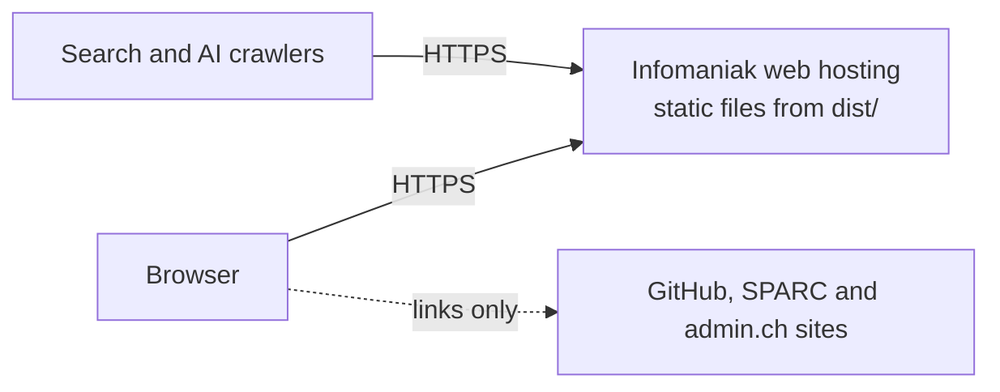
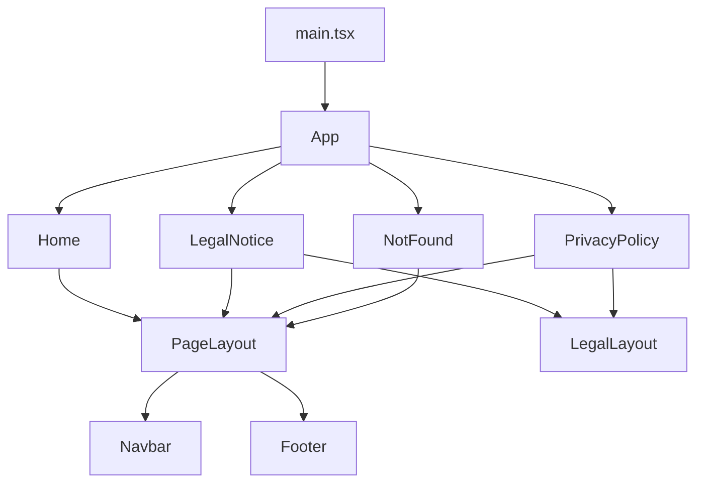

# Architecture

SPRAC Handbook is a static website. There is no backend, database, login or form: the build produces plain HTML, CSS, JavaScript and images that any web host can serve. React renders the pages at build time and takes over in the browser for navigation.

> [!NOTE]
> Not update/does not reflect the current system

## System context

Nothing is loaded from third parties: fonts, icons and images are served from the same host. The only data kept in the browser is a flag in `localStorage` (key `sprac.disclaimer-accepted`) that records that the disclaimer was accepted.

## Components

| Path                     | Responsibility                                                                                                                          |
| ------------------------ | --------------------------------------------------------------------------------------------------------------------------------------- |
| `src/main.tsx`           | Mounts the app: hydrates pre-rendered HTML, otherwise renders from scratch                                                              |
| `src/App.tsx`            | Reads the URL and picks the page                                                                                                        |
| `src/pages/`             | One component per page; `Home/` is split into one component per section                                                                 |
| `src/components/layout/` | Navbar, logo, footer, page frame, the mobile menu (`MobileNav.tsx`) and its animation (`useMenuMotion.ts`)                              |
| `src/components/legal/`  | Building blocks shared by the legal notice and privacy policy                                                                           |
| `src/components/ui/`     | Button, icon, callout, first-visit disclaimer (`DisclaimerDialog`)                                                                      |
| `content/`               | All page text and the paths of icons and logos, one Markdown file per page (see [CONTENT.md](CONTENT.md))                               |
| `src/content/`           | Reads the Markdown files: parser (`markdown.ts`), one reader per page (`program.ts` is shared by SPARC and CyLG), page titles (`siteMeta.ts`) |
| `src/router/`            | Route table (`pages.ts`), URL helpers (`routes.ts`), history navigation and `Link`                                                      |
| `src/seo/`               | Head tags, JSON-LD and sitemap (`meta.ts`); keeps them in sync in the browser (`usePageMeta.ts`)                                        |
| `src/config/`            | Repository address, asset URLs and icon names                                                                                           |
| `src/entry-server.ts`    | Renders one path to HTML at build time                                                                                                  |
| `vite.config.ts`         | Build plugins: CSP, per-page HTML files, sitemap, pre-rendering                                                                         |
| `public/`                | Served unchanged: favicons, icons, logos, social image, `robots.txt`, `llms.txt`, `humans.txt`, `.htaccess`, `.well-known/security.txt` |

## Routing

Pages use a trailing slash:

| Path               | Page                      |
| ------------------ | ------------------------- |
| `/`                | Home                      |
| `/sparc/`          | SPARC                     |
| `/cylg/`           | Cyber Lehrgang            |
| `/legal-notice/`   | Legal notice              |
| `/privacy-policy/` | Privacy policy            |
| anything else      | Not found                 |

There is no router library. `src/router/navigation.ts` wraps the History API and exposes the current path through `useSyncExternalStore`; `Link` intercepts plain clicks so internal links do not reload the page.

## Content

The site is English only. All page text lives in Markdown files in `content/`, named after the page's URL. A small parser in `src/content/markdown.ts` reads them (the site only adds `motion` to React, so there is no Markdown library), and one reader per page turns a file into the typed data its components use. The files are bundled as text at build time, so the browser and the pre-render read the same content. `vite.config.ts` reads the front matter of the files directly to write each page's title, description and sitemap entry. The format is described in [CONTENT.md](CONTENT.md).

## Build

`npm run build` runs `tsc -b` and then `vite build`, which adds four steps through plugins in `vite.config.ts`:

1. **Content Security Policy**: a strict same-origin CSP is injected as a `<meta>` tag into every page (build only, because the dev server needs inline styles).
2. **Per-page HTML** (`seoPages`): for every page, a copy of `index.html` with its own title, description, canonical URL, Open Graph tags and JSON-LD, written to `<page>/index.html`. Also writes `404.html` (with `noindex`) and `sitemap.xml`.
3. **Pre-rendering** (`prerender`): builds `src/entry-server.ts` for Node, renders each page to HTML and puts it into its file. The text is then readable without JavaScript, which matters for AI crawlers.
4. **Hydration**: in the browser, `main.tsx` compares `data-prerendered` on the root element with the current path. If they match, React hydrates the existing HTML; on `404.html` or in development it renders from scratch.

Head tags, the sitemap and the route list all come from `src/router/pages.ts` and `src/seo/meta.ts`, so they cannot drift apart.

## Base path

The site can be served from a subpath. Two environment variables, read in `vite.config.ts` at build time, set it:

| Variable      | Default            | Effect                                                                                                                                                                                                   |
| ------------- | ------------------ | -------------------------------------------------------------------------------------------------------------------------------------------------------------------------------------------------------- |
| `BASE_PATH`   | `/`                | Subpath the site is served from, e.g. `/handbook`. Becomes Vite's `base`, so asset URLs, `import.meta.env.BASE_URL` (used by `buildPath` and `publicUrl`) and `%BASE_URL%` in `index.html` include it. |
| `SITE_ORIGIN` | `https://sprac.ch` | Origin for canonical, Open Graph, JSON-LD and sitemap URLs; the base path is appended.                                                                                                                   |

Internal links always go through `buildPath` and public files through `asset`, **never hard-code `/...` paths**.

## Deployment

`.github/workflows/cd.yml` builds on every push and pull request to `main` and deploys pushes to GitHub Pages at `https://sprac-ch.github.io/handbook/`. It takes `BASE_PATH` and `SITE_ORIGIN` from `actions/configure-pages`, so a custom domain set in the repository settings switches the build to the root of that domain. The repository's Pages source must be set to "GitHub Actions".

## Hosting and security

The site is hosted by Infomaniak (Apache). `public/.htaccess` is copied into `dist/` and:

- redirects HTTP and `www.sprac.ch` to `https://sprac.ch`
- serves `404.html` for unknown paths
- sets the headers a `<meta>` tag cannot: HSTS, `frame-ancestors 'none'`, `X-Frame-Options`, `X-Content-Type-Options`, `Referrer-Policy`, `Permissions-Policy`, `Cross-Origin-Opener-Policy`
- caches hashed build files for a year and revalidates HTML and text files on every visit

Security contact details are in `public/.well-known/security.txt` (RFC 9116).

## Known limitations

- sprac.ch does not serve the site yet and its HTTPS certificate is self-signed.
- The "Open an issue" button points to `#` until an issue tracker is set up (`ISSUE_URL` in `src/config/links.ts`).
- The full-site navbar (Programs, Path, FAQ, Glossary) and the extra footer links are not built yet, because those pages do not exist yet.
- Romansh text and the legal texts in German, French, Italian and Romansh still need review by native speakers.
